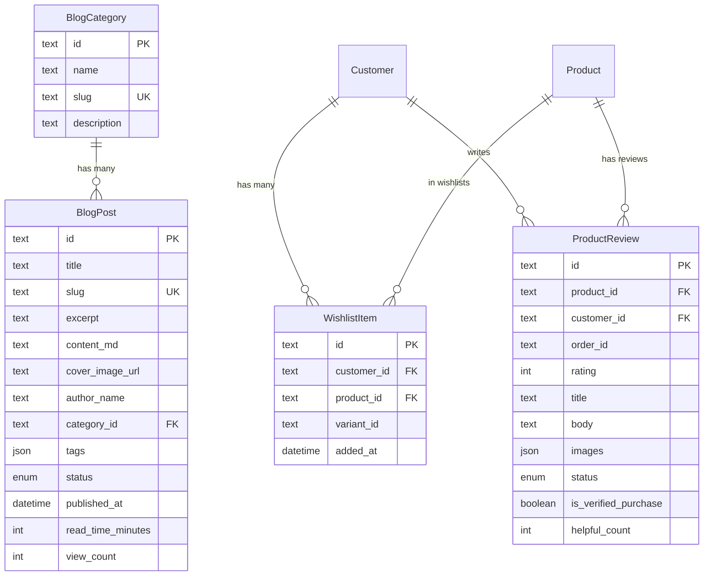

# Database Schema — Complete Specification

---

## New Modules Required

### 1. Blog Module (`apps/medusa/src/modules/blog/`)

```
models/
  blog-post.ts
  blog-category.ts
service.ts
index.ts
migrations/
  Migration[timestamp].ts
```

#### BlogPost Model
```ts
export const BlogPost = model.define("blog_post", {
  id: model.id({ prefix: "post" }).primaryKey(),
  title: model.text(),
  slug: model.text(),                    // unique, URL-friendly
  excerpt: model.text().nullable(),      // 160 chars for SEO description
  content_md: model.text(),              // Markdown body
  cover_image_url: model.text().nullable(),
  author_name: model.text().default("Legacy Crafts"),
  author_avatar_url: model.text().nullable(),
  category_id: model.text().nullable(),
  tags: model.json().default([]),        // string[]
  status: model.enum(["draft", "published", "archived"]).default("draft"),
  published_at: model.dateTime().nullable(),
  seo_title: model.text().nullable(),    // Override meta title
  seo_description: model.text().nullable(),
  read_time_minutes: model.number().default(5),
  view_count: model.number().default(0),
  category: model.belongsTo(() => BlogCategory, { mappedBy: "posts" }),
})

export const BlogCategory = model.define("blog_category", {
  id: model.id({ prefix: "blogcat" }).primaryKey(),
  name: model.text(),
  slug: model.text(),
  description: model.text().nullable(),
  posts: model.hasMany(() => BlogPost, { mappedBy: "category" }),
})
```

### 2. Wishlist Module (`apps/medusa/src/modules/wishlist/`)

```
models/
  wishlist-item.ts
service.ts
index.ts
migrations/
  Migration[timestamp].ts
```

#### WishlistItem Model
```ts
export const WishlistItem = model.define("wishlist_item", {
  id: model.id({ prefix: "wish" }).primaryKey(),
  customer_id: model.text(),
  product_id: model.text(),
  variant_id: model.text().nullable(),
  added_at: model.dateTime(),
})
```

### 3. Reviews Module (`apps/medusa/src/modules/reviews/`)

```
models/
  product-review.ts
service.ts
index.ts
migrations/
  Migration[timestamp].ts
```

#### ProductReview Model
```ts
export const ProductReview = model.define("product_review", {
  id: model.id({ prefix: "rev" }).primaryKey(),
  product_id: model.text(),
  customer_id: model.text(),
  order_id: model.text().nullable(),      // verified purchase
  rating: model.number(),                  // 1-5
  title: model.text().nullable(),
  body: model.text().nullable(),
  images: model.json().default([]),        // string[] URLs
  status: model.enum(["pending", "approved", "rejected"]).default("pending"),
  is_verified_purchase: model.boolean().default(false),
  helpful_count: model.number().default(0),
})
```

---

## Indexes

| Table | Columns | Type |
|-------|---------|------|
| blog_post | slug | UNIQUE |
| blog_post | status, published_at | COMPOSITE (for listing) |
| blog_post | category_id | FK |
| blog_category | slug | UNIQUE |
| wishlist_item | customer_id, product_id | UNIQUE (prevent dupes) |
| wishlist_item | customer_id | INDEX |
| product_review | product_id, status | COMPOSITE |
| product_review | customer_id | INDEX |
| product_review | rating | INDEX |

---

## Medusa Config Registration

```ts
// medusa-config.ts additions
modules: [
  // ... existing modules ...
  { resolve: "./src/modules/blog", options: {} },
  { resolve: "./src/modules/wishlist", options: {} },
  { resolve: "./src/modules/reviews", options: {} },
]
```

---

## Entity Relationship Diagram



---

## Migration Strategy

1. Generate migrations per module: `npx medusa db:generate blog`
2. Run: `npx medusa db:migrate`
3. Seed blog categories and initial posts via a seed script
4. Seed sample reviews for existing products

---

## Seed Data

### Blog Categories
```ts
const categories = [
  { name: "Craftsmanship", slug: "craftsmanship" },
  { name: "Materials", slug: "materials" },
  { name: "Design", slug: "design" },
  { name: "Behind the Scenes", slug: "behind-the-scenes" },
]
```

### Sample Reviews (for existing 3 products)
```ts
// 5 reviews per product, ratings 3-5, various lengths
// Some with images, some verified purchases
```
