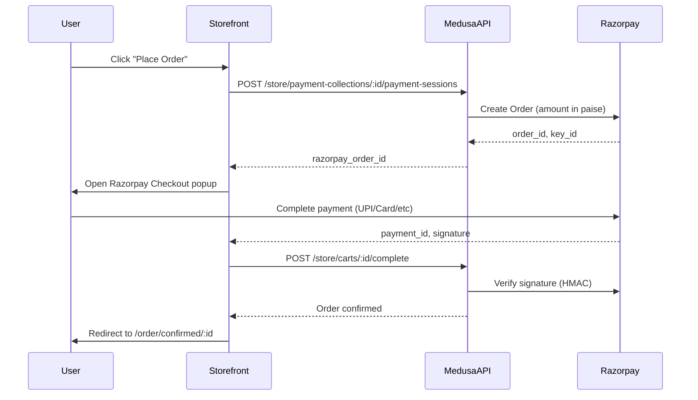

# Cart & Checkout Pages — Complete Specification

---

## Cart Page (`/cart`)

### Layout

```
┌─────────────────────────────────────────────────────┐
│ [Header]: "Your Cart (3 items)"                     │
├──────────────────────────────┬──────────────────────┤
│ [Cart Items List]            │ [Order Summary]      │
│                              │                      │
│ ┌─────┬─────────────────┐   │ Subtotal    ₹25,497  │
│ │ img │ Title            │   │ Shipping    Free     │
│ │     │ Variant: Oak     │   │ Tax         ₹4,589  │
│ │     │ [-] 1 [+]  ₹12k │   │─────────────────────│
│ │     │ [Remove] [Save]  │   │ Total       ₹30,086 │
│ └─────┴─────────────────┘   │                      │
│                              │ [Promo Code Input]   │
│ ┌─────┬─────────────────┐   │ [Apply]              │
│ │ img │ Title            │   │                      │
│ │     │ Variant: Crystal │   │ [Checkout →]         │
│ │     │ [-] 2 [+]  ₹5k  │   │                      │
│ └─────┴─────────────────┘   │ [Secure Checkout 🔒]  │
│                              │ [Accepted: Visa MC]  │
├──────────────────────────────┴──────────────────────┤
│ [Cross-sell: "Complete the Look"]                    │
│ [4 product cards in carousel]                       │
└─────────────────────────────────────────────────────┘
```

### Cart Item Card
```
┌────────┬────────────────────────────────────────────┐
│        │ [Product Name]              [Line Total]    │
│ [Img]  │ [Variant: Oak / Large]                     │
│ 100x100│ [Customized ✓] (if design attached)       │
│rounded │ [Qty: [-] 1 [+]]                          │
│        │ [Remove] [Save for Later] [Edit Design]    │
└────────┴────────────────────────────────────────────┘
```

### Empty Cart State
```
┌─────────────────────────────────────────────────────┐
│              [Illustration: empty bag]                │
│         "Your cart is empty"                        │
│     "Explore our collection to find..."             │
│         [Continue Shopping →]                        │
│                                                      │
│     [Popular picks carousel]                         │
└─────────────────────────────────────────────────────┘
```

### Promo Code
- Input + Apply button inline
- Success: green checkmark + "20% off applied!"
- Error: red border + "Invalid code"
- Applied: shows as pill badge with X to remove

### Mobile Cart
- Summary collapses to sticky bottom bar: `Total: ₹30,086 [Checkout]`
- Items take full width
- Quantity stepper smaller

---

## Checkout Page (`/checkout`)

### 4-Step Wizard Flow

```
Step indicator: ● Contact ─── ● Shipping ─── ○ Payment ─── ○ Review
                 (active)       (completed)    (upcoming)     (upcoming)
```

### Step 1: Contact & Shipping Address

```
┌─────────────────────────────────────────────────────┐
│ [Email]                 (full width)                 │
│ [First Name] [Last Name]                            │
│ [Phone]                                             │
│─────────────────────────────────────────────────────│
│ SHIPPING ADDRESS                                     │
│ [Address Line 1]       (full width)                 │
│ [Address Line 2]       (full width, optional)       │
│ [City]    [State ▾]    [PIN Code]                   │
│ [Country ▾] (default: India)                        │
│─────────────────────────────────────────────────────│
│ □ Save this address for future orders               │
│ □ Billing address same as shipping                  │
│─────────────────────────────────────────────────────│
│                              [Continue to Shipping →]│
└─────────────────────────────────────────────────────┘
```

### Step 2: Delivery Method

```
┌─────────────────────────────────────────────────────┐
│ SELECT DELIVERY METHOD                               │
│                                                      │
│ ┌──────────────────────────────────────────────┐    │
│ │ ● Standard Delivery                    FREE   │    │
│ │   5-7 business days                           │    │
│ └──────────────────────────────────────────────┘    │
│ ┌──────────────────────────────────────────────┐    │
│ │ ○ Express Delivery                    ₹299    │    │
│ │   2-3 business days                           │    │
│ └──────────────────────────────────────────────┘    │
│                                                      │
│ [← Back]                    [Continue to Payment →]  │
└─────────────────────────────────────────────────────┘
```

### Step 3: Payment

#### For Regular Orders (Razorpay)
```
┌─────────────────────────────────────────────────────┐
│ PAYMENT METHOD                                       │
│                                                      │
│ ┌──────────────────────────────────────────────┐    │
│ │ ● Pay with Razorpay                           │    │
│ │   UPI • Cards • Net Banking • Wallets         │    │
│ │   [Razorpay logo badges]                      │    │
│ └──────────────────────────────────────────────┘    │
│ ┌──────────────────────────────────────────────┐    │
│ │ ○ Cash on Delivery                    +₹49    │    │
│ │   Pay when your order arrives                 │    │
│ └──────────────────────────────────────────────┘    │
│                                                      │
│ 🔒 Your payment information is secure                │
│                                                      │
│ [← Back]                       [Continue to Review →]│
└─────────────────────────────────────────────────────┘
```

#### For Corporate Net-Terms Orders
```
┌─────────────────────────────────────────────────────┐
│ CORPORATE BILLING                                    │
│                                                      │
│ ┌──────────────────────────────────────────────┐    │
│ │ ✓ Pay on Account (Net 30)                     │    │
│ │   Billed to: Acme Corp                        │    │
│ │   PO: PO-2026-0042                            │    │
│ │   Credit remaining: ₹1,45,000                 │    │
│ └──────────────────────────────────────────────┘    │
│                                                      │
│ [← Back]                       [Continue to Review →]│
└─────────────────────────────────────────────────────┘
```

### Step 4: Review & Place Order

```
┌─────────────────────────────────────────────────────┐
│ REVIEW YOUR ORDER                                    │
│                                                      │
│ Shipping to:    John Doe, 123 MG Road, Bangalore... │
│ Delivery:       Standard (5-7 days)                  │
│ Payment:        Razorpay                             │
│                                                      │
│ ┌───────────────────────────────────────────────┐   │
│ │ [Items summary — collapsed, expandable]       │   │
│ │ 3 items • ₹25,497                            │   │
│ └───────────────────────────────────────────────┘   │
│                                                      │
│ □ I agree to the Terms & Conditions                 │
│                                                      │
│ [← Back]                          [Place Order ₹30k] │
│                                                      │
│ Custom trophy orders are non-returnable.             │
└─────────────────────────────────────────────────────┘
```

---

## Razorpay Integration Flow



### Razorpay Checkout.js Options
```ts
{
  key: process.env.NEXT_PUBLIC_RAZORPAY_KEY_ID,
  amount: cart.total * 100, // paise
  currency: "INR",
  name: "Trophy Heaven",
  description: `Order #${cart.id}`,
  order_id: razorpayOrderId,
  prefill: { email, contact: phone, name },
  theme: { color: "#8A2D25" }, // brand-trophy accent
  modal: { ondismiss: handleCancel }
}
```

---

## Order Summary Sidebar (persists across all steps)

```
┌──────────────────────────────────┐
│ ORDER SUMMARY                     │
│──────────────────────────────────│
│ [Collapsible item list]          │
│   Crystal Award × 2    ₹4,998   │
│   Oak Side Table × 1   ₹12,999  │
│   Wooden Plaque × 1    ₹2,499   │
│──────────────────────────────────│
│ Subtotal               ₹20,496  │
│ Shipping               FREE     │
│ Tax (GST 18%)          ₹3,689   │
│ Promo (-20%)          -₹4,099   │
│══════════════════════════════════│
│ TOTAL                  ₹20,086  │
│ (or ₹1,674/month × 12)         │
└──────────────────────────────────┘
```

---

## Order Confirmation Page (`/order/confirmed/[id]`)

```
┌─────────────────────────────────────────────────────┐
│ ✓ ORDER CONFIRMED                                    │
│                                                      │
│ Thank you, John!                                    │
│ Order #LC-ORD-2026-1234                             │
│                                                      │
│ A confirmation email has been sent to john@...      │
│                                                      │
│ ┌───────────────────────────────────────────────┐   │
│ │ Delivery estimate: Aug 28 — Sep 2             │   │
│ │ Shipping to: 123 MG Road, Bangalore           │   │
│ │ Payment: Razorpay (₹20,086)                   │   │
│ └───────────────────────────────────────────────┘   │
│                                                      │
│ [Track Order]  [Continue Shopping]                   │
│                                                      │
│ ─── Share your purchase ───                         │
│ [WhatsApp] [Twitter] [Copy Link]                    │
└─────────────────────────────────────────────────────┘
```

---

## Form Validation

| Field | Rules | Error Message |
|-------|-------|---------------|
| Email | Required, valid email | "Please enter a valid email" |
| First Name | Required, 2+ chars | "First name is required" |
| Phone | Required, 10 digits (India) | "Please enter a valid phone number" |
| Address | Required, 5+ chars | "Please enter your full address" |
| City | Required | "City is required" |
| PIN Code | Required, 6 digits | "Please enter a valid PIN code" |
| State | Required, select | "Please select your state" |

### Validation UX
- Validate on blur (not on type)
- Show error below field with red border
- Success: green checkmark icon in field
- Prevent step advancement if invalid
- Scroll to first error field
