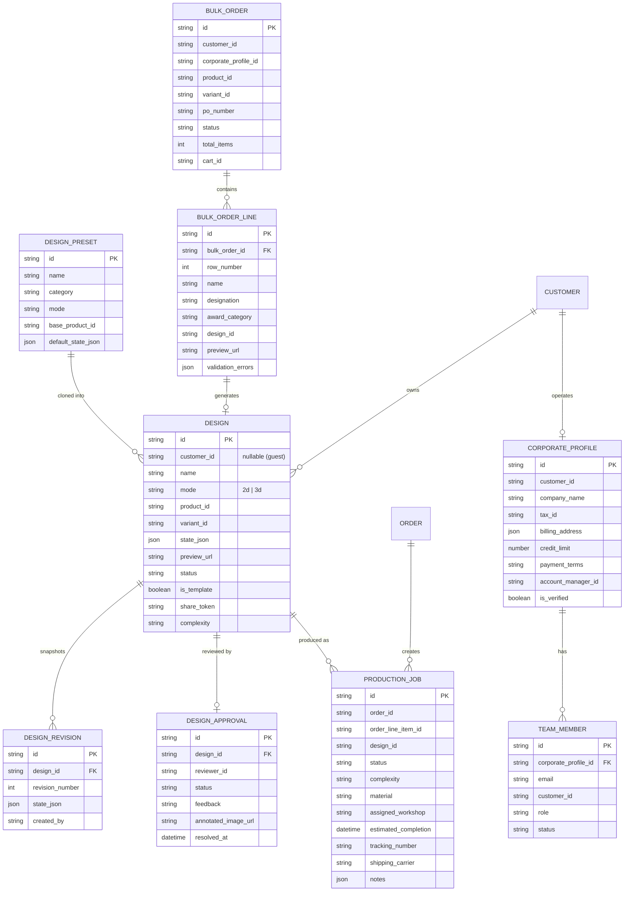

# Entity-Relationship Diagram

Custom Legacy Crafts entities layered on top of Medusa's core commerce models
(Product, Variant, Cart, Order, Customer, Payment). Core Medusa entities are
shown only where custom entities reference them (by id, no FK across modules —
Medusa module isolation).

## Custom events (Redis event bus)

`design.submitted`, `design.approved`, `design.rejected`, `production.started`,
`production.completed`, `production.status_changed`, `bulkorder.parsed`,
`corporate.credit_exceeded`. Subscribers handle notifications, production-job
creation, and status sync (see `apps/medusa/src/subscribers`).
